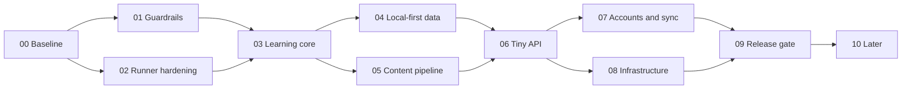

# CodeType architecture: build phases

One place for the build order. Every file here is grounded in what the repo contains today, checked against `main` at commit `21657f9` ("Initial CodeType SICP release") on 2026-11-23. Where a claim comes from reading code, the phase file names the file.

## How to use these files

- One file per phase in [`phases/`](phases/). Each step has **Size**, **Acceptance criteria**, **Verification** and **Blocked by**, the same format as the owner's production plan.
- Sizes: **S** about half a day, **M** one to two days, **L** three days or more. These are starting guesses; recalibrate after Phase 01.
- A step is done only when its verification has been run and the result is written under **Evidence** at the bottom of the phase file.
- The owner writes the code. Reviews and questions come from the mentor. Tests come before fixes.
- [`decisions.md`](decisions.md) holds every choice that is still open, with the default used in these files. Change a default there first, then update the phases that depend on it.
- [`overview.md`](overview.md) shows the current and target architecture, the dependency rules and the trust boundaries.

## Phase map

| # | Phase | Outcome | Status | Plan phase |
| --- | --- | --- | --- | --- |
| 00 | [Baseline and source of truth](phases/00-baseline.md) | One canonical app, a feature inventory, baseline numbers | Not started | new |
| 01 | [Guardrails](phases/01-guardrails.md) | Risk gate running on real PRs, including a fork PR | Built locally, not yet run on GitHub | 1 |
| 02 | [Runner hardening](phases/02-runner-hardening.md) | A runaway loop can be stopped, errors and test results have a contract | Not started | 2 |
| 03 | [Learning core](phases/03-learning-core.md) | Mastery decided from evidence, failures counted, XP and streak derived | Not started | 3, 4 |
| 04 | [Local-first data layer](phases/04-local-first-data.md) | Append-only event log in the browser, no silent data loss | Not started | 3, 5 |
| 05 | [Content pipeline](phases/05-content-pipeline.md) | Content as validated JSON with permanent ids | Not started | 4 |
| 06 | [Tiny API](phases/06-tiny-api.md) | Identity, idempotent event ingest, sync, leaderboard | Not started | 5 |
| 07 | [Accounts and sync in the client](phases/07-accounts-and-sync.md) | Two devices, one learner, no double counting | Not started | 5 |
| 08 | [Infrastructure](phases/08-infrastructure.md) | One command builds the server, a restore has been tested | Not started | 6 |
| 09 | [Release gate](phases/09-release-gate.md) | Accessibility, security and load checklist all green | Not started | 7 |
| 10 | [Later](phases/10-later.md) | Deferred ideas, each with a trigger for starting it | Parked | fog |

The plan's Phase 3 ("split the monolith") is largely done in this repo already: `src/` is modular and has tests. Phase 00 decides whether this repo or the single-file monolith is the base, because that choice changes Phases 02 to 04.

## Dependency graph

Step 06.1 (the event schema on paper) has no blocker and can be done at any time.

## Rules that apply to every phase

**Always**
- Tests before fixes.
- Content is human-curated.
- A backup counts only after a restore has been tested at least once.
- Secrets are referred to by name, never written down or committed.
- Keep the calm design language. Evidence of learning over vanity metrics.

**Never**
- Run untrusted code on a server outside an isolated container.
- Claim a sandbox where there is none. Pyodide in the browser is not one.
- Rename or delete a content id. Mark it `deprecated`.
- Hardcode a secret.
- Start an ML model before the labelled data exists.

## How a change lands

1. Open one issue per step before work starts.
2. Work on a branch, open a small PR. The risk gate (Phase 01) decides whether it needs a human review.
3. Keep each PR to one step. A PR over about 600 changed lines together with a dependency file, or over 1,500 lines or 40 files on its own, is treated as out of distribution and always needs review.
4. The very first commit of the gate goes straight to `main`: the workflow can only judge PRs with a tool that already exists on the base branch.
5. Merged is not deployed. After each deploy, compare what is running with `main` (Phase 08).
