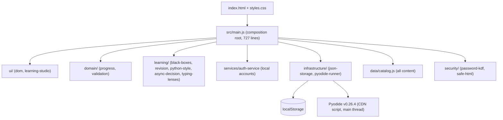
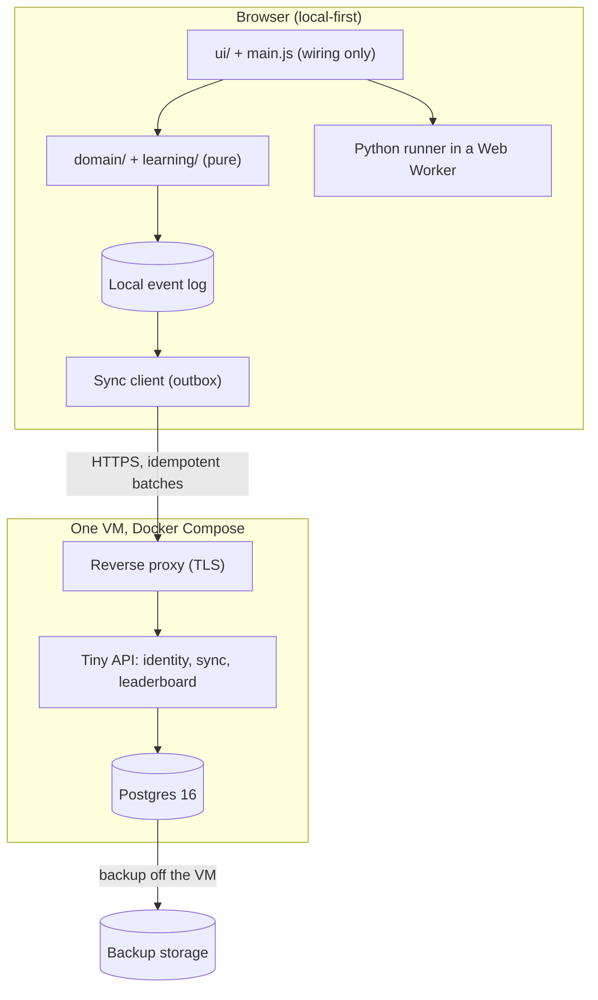

# Architecture overview

Where the system is today, where it is going, and the rules that keep the phases from turning into a rewrite. The root [`ARCHITECTURE.md`](../../ARCHITECTURE.md) describes the learning design (the SICP-inspired boundaries); this file describes how the system grows.

## Today (verified in the repo)

Facts this picture rests on:

- Everything runs in one browser page. There is no network call except the Pyodide script (`index.html`, pinned to v0.26.4, no `integrity` attribute, no CSP).
- Progress is one mutable record per user in `localStorage` (`codetype:user:<name>`), schema version 2. XP is a counter (`addXp` in `domain/progress.js`).
- Accounts are local: PBKDF2 hashes in `localStorage` (`services/auth-service.js`, `security/password-kdf.js`).
- The leaderboard is the local users plus five fixed fake peers from `catalog.peers`.
- Python runs on the page's main thread. Nothing in the code can stop a runaway loop.
- 34 Node tests pass (`npm test`): domain, learning, security and startup. `tests/security.browser.html` is a manual browser check.

## Target

What changes, and in which phase:

| Change | Phase |
| --- | --- |
| Python moves into a Web Worker with a timeout; test results become structured | 02 |
| Mastery, spaced review, XP and streak become pure functions over attempt events | 03 |
| Progress becomes an append-only event log; corrupt data is never overwritten | 04 |
| Content moves from `catalog.js` to validated JSON with permanent ids | 05 |
| A tiny API owns identity, event ingest, sync and the leaderboard | 06 |
| The client gets an API client, an outbox and visible sync status | 07 |
| One VM, Compose, backups with a tested restore | 08 |

What does **not** change: the browser app stays the place where learning happens, and it keeps working with no network.

## Dependency rules

These make each phase small, because a pure module can be tested without a browser.

| Layer | May depend on | Must not |
| --- | --- | --- |
| `domain/`, `learning/` | nothing except each other and `config.js` | touch the DOM, storage, network, or the real clock (inject `now`) |
| `infrastructure/` | `domain/`, `config.js` | contain learning rules |
| `services/` | `domain/`, `infrastructure/` through injected ports | render anything |
| `ui/` | its own helpers, data passed in by callbacks | read storage or call the network |
| `main.js` | everything, to wire it | hold business rules |

`main.js` is 727 lines today and mixes wiring with view logic (for example `renderLeaderboard` assembles rows from storage and `runCurrentChallenge` drives a run). Each phase that touches a feature moves that feature's logic out of `main.js` instead of one big refactor.

## Trust boundaries

| What | Computed in | Trusted for |
| --- | --- | --- |
| Typing drills, personal mastery, study plan | Browser | The learner's own view only |
| XP, level, streak shown to the learner | Browser, derived from events | The learner's own view; the server recomputes |
| Leaderboard, any certificate or badge others can see | Server, from events | Everyone |
| Pass or fail of learner code in self-study | Browser (Pyodide) | Self-study only. Learner code and tests share one interpreter, so it can be gamed |
| Pass or fail used for ranking (Pro problems) | A server-side isolated container (Phase 10) | Ranking |
| Identity | Server | Everything |

## How one event travels

1. The learner finishes an attempt. The browser creates an event with a new `idempotency_key` and appends it to the local log.
2. The UI shows the derived progress immediately. Nothing waits for the network.
3. The sync client sends unsent events in a batch. The same key is reused on every retry.
4. The server inserts each event once (`UNIQUE` on the key) and answers per event: accepted, duplicate or rejected.
5. The server computes what the event is worth. A client-sent XP value is ignored.
6. Other devices pull events after a server-side cursor and append them to their own logs.

## Targets that need numbers from the owner

These are open in [`decisions.md`](decisions.md) (D-13): how many events may be lost if the VM is destroyed, how long downtime is acceptable, how long a restore may take. Phase 08 cannot be signed off without them.
